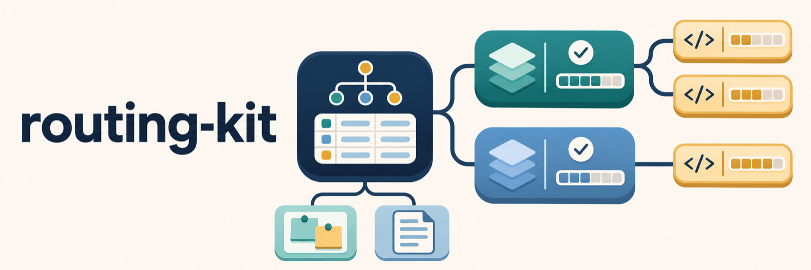

<picture>
  <source media="(prefers-color-scheme: dark)" srcset="docs/header-dark.png">
  
</picture>
# routing-kit

Decides which AI model does which job, by a field guide of the current models. It installs for
Claude Code, Codex or Gemini (Antigravity), whichever you mainly work in.

## If you are an AI agent

The person who gave you this link wants routing-kit set up. Fetch `START-HERE.md` from this repo
and follow it step by step.

If you are the person, paste this into your agent (Claude Code, Codex or Gemini):

```
Set up https://github.com/Jakobuus/claude-routing-kit for me
```

## What it is

- **What it does.** Your main agent stays in charge: it plans, reviews and talks to you. The
  building goes to cheaper models: Claude's smaller models and, if you have them, OpenAI's Codex,
  Google's Gemini and Jules, Kimi or GLM. Before handing out work, it checks how much of each plan
  you have used this week and picks the one with the most room left. No plan runs out early while
  another sits unused.
- **Who it is for.** People who use Claude Code, Codex or Gemini and pay for more than one AI plan,
  or want to.
- **What you get.** A set of working rules that load at the start of every session, a table of
  which model does which job for your plans, build commands for each helper, a usage check
  (`kit-quota`), and a self-test.
- **What it needs.** One of the three agents on macOS, Linux, or Windows through WSL2. Everything
  else is optional.

## Everything it does

- Shares one source of rules across Claude Code, Codex and Gemini in Antigravity.
- Gives you a routing table for which model does each job. Usage readings help choose between eligible models and spread work across plans.
- Offers guards that block destructive commands and protect folders you choose. You decide whether to turn them on.
- Gives your agents a board for notes, claims and messages, so they can coordinate.
- Suggests tools for media and document jobs based on what you have available.
- Shows usage and reset information across your enabled plans with `kit-quota`.
- Hands builds to Codex, Gemini or Jules and saves a patch you can review.
- Checks the kit's health with `kit-doctor` and lets you undo shared rules, skills and hooks.

## How you use it

1. Give [START-HERE](START-HERE.md) to your agent to install the kit. Answer questions about your plans, helpers and guards.
2. Start a new session. Your agent receives your routing table and any health or board notices at the start; ask it to show them when you want to see them.
3. Work as usual. Your agent loads the rules, and the guards you enabled check commands as it works.
4. Ask your agent to hand off a build. It can use `kit-codex-build`, `kit-gemini-build` or `kit-jules-build`. Review the patch, apply it in a test checkout, and run your checks before you commit or merge.
5. Run `kit-quota` to see usage. Run `kit-quota --pick "Lookups, bulk edits, data entry"` to choose an eligible model for that row.
6. Agents can leave notes with `kit-board post` or send messages with `kit-board send --to TARGET TEXT`. Use `kit-board read` to read the board.
7. For Claude Code, update with `claude plugin update routing-kit@routing-kit`, then run `kit-sync all` and start a new session. Run `kit-doctor` to check health. Use `kit-sync all --undo` to remove the shared rules, skills and hooks.

Details: [What you get in 0.4](#what-you-get-in-04) · [Usage and build commands](#usage-and-build-commands) · [START-HERE](START-HERE.md)

## What you get in 0.4

Claude Code, Codex or Antigravity can lead (Antigravity as lead is not tested end to end yet). Setup asks what plans and models you have and which agent should lead. Claude is the default.

`kit-sync all` shares rules, skills and hooks. Shared skills are the kit's own skills plus skill folders listed under `skills` in your profile. Edit `skills` and `products` by hand in `~/.config/routing-kit/profile.json`; `kit-route` uses `products` to find options for media and document jobs.

`kit-sync repo PATH` moves a repo's rule files into one shared AGENTS.md and commits the change (undo with `git revert`). `kit-sync rules|skills|hooks --undo` (or `kit-sync all --undo`) takes out the kit's rules block, skill links and hook entries (and the Codex trust block it wrote at the end of config.toml, if it is still the last thing there). It never restores old copies. `kit-sync hooks` marks the kit's Codex hooks trusted in Codex's config.toml only after `kit-selftest --hooks` passes; a failed selftest removes the mark again. It leaves the `project_doc_max_bytes` line in Codex's config.toml; remove it by hand if you want. It refuses a rules block edited by hand unless you add `--force`.

`kit-doctor --setup` checks your profile, installed agents and sign-ins, routed models, synced rules, skills and hooks, Codex hook trust, and Paseo. Each line says `ok`, gives a fix, or makes an optional recommendation; it never enables Paseo. Exit 1 means something needs fixing. Add `--json` for structured results. `--fast` stays silent when its file and PATH checks pass.

`kit-doctor` lists hand edits and missing pieces in what kit-sync wrote, rule files too big for an agent, new hook errors since the last check, and media jobs from the last 7 days with how many got a suggested route (it cannot tell whether the agent followed it). `kit-board` supports notes, claims and messages; inside Claude Code, Codex or Antigravity it knows which session you are from the agent's own session id (`kit-board whoami`). `KIT_BOARD_NAME` is for scripts outside an agent. A Claude session started from inside a Codex session is named as Codex. Owner quotes show as `<owner> says (quoted via …)`, with the profile's `owner_name` (`kit-profile set owner_name NAME`), or "the owner". Another agent's note is not the owner's approval. `kit-quota --pick "<row name from the routing table>"`, for example `kit-quota --pick "Lookups, bulk edits, data entry"`, names the model in that row whose plan has the most room left this week.

Setup offers two guards: one against destructive commands, and one that stops agents working in other repos from editing files in folders you name as your own (`kit-profile set owner_checkouts '["/path"]'`). Both are off unless you say yes; they are a seatbelt against agent mistakes, not a security boundary. Codex: `kit-sync hooks` runs the hooks selftest and, only if it passes, marks the kit hooks trusted in Codex (one marked block at the end of `$CODEX_HOME/config.toml`, by default `~/.codex/config.toml`), so they also run in `codex exec`. A failed selftest or `--undo` removes that block if it is still the exact last part of the file; otherwise kit-sync says so and you remove it by hand. If kit-sync prints a trust warning, check `/hooks` in Codex.

Your private rules belong in `~/.config/routing-kit/private/rules.md` (or `$ROUTING_KIT_HOME/private/rules.md` if you set ROUTING_KIT_HOME). When migrating, move your text there by hand and empty the old file before running `kit-sync rules`. Run `kit-profile set kit_rules replace` only once the private file holds your full rules. The kit then keeps only the private rules file and the routing table.

## Usage and build commands

### kit-quota

Shows plan usage so work can go to the plan with room left. Fable's cap sits inside
Claude's week: it is not extra headroom. Readings older than 30 minutes show `(stale)`.

| Setting | Default and purpose |
|---|---|
| Profile `claude_usage_db`, or `QUOTA_CLAUDE_DB` | Optional Claude usage database; unset uses the status-line readings. The environment setting takes priority. |
| `QUOTA_STALE_SECS` | 1800 seconds before a reading is stale. |
| Profile `claude_resets_file` | Optional JSON file for banked Claude resets; Codex banked resets are read live. |
| Profile `jules_daily_limit` | 100 jobs per day; set it to your Jules plan's limit. |
| `QUOTA_*` test stubs | `QUOTA_CODEX_CMD`, `QUOTA_GEMINI_CMD`, `QUOTA_JULES_CMD` replace provider reads; `QUOTA_CLAUDE_RESETS_CMD` and `QUOTA_CODEX_RESETS_CMD` replace reset reads. `QUOTA_NOW` fixes the clock for tests. Leave these unset for normal use. |

### kit-codex-build

Builds from committed HEAD and saves `build.patch` for review. Direct Codex is the default; Paseo
is the default only when the profile key `codex_build_transport` is `paseo`
(`kit-profile set codex_build_transport paseo|direct`). The profile key `paseo` is only the
Paseo-pill flag and does not change builds. `--paseo` and `--no-paseo` override the setting.
Each Paseo run writes `result.md`, `log.txt` and `manifest.json` with its status, paths and
cleanup details; `exit` in the manifest is a number. Nothing is archived before the patch is
saved and checked. The copy is then deleted, or moved to `retained` if something in it is not
saved (see kit-retained). The checked build is also kept as the branch `refs/heads/kit-codex/<run>` in the
source repo. Every exit after the run folder exists ends with
`kit-codex-build: exit=N patch=PATH result=PATH`. A commit you make in the repo while a build
runs does not break it. A Paseo run also keeps a short-lived `head-*` copy in the kit home, which a
later run removes if it is more than a day old. The brief is copied first, and that copy is scanned
and sent. Verified once with a real Paseo run: a `CLAUDE_*` variable exported by the caller did
not reach the agent.

| Flag, setting or exit | Meaning |
|---|---|
| `--paseo` / `--no-paseo` | Override `codex_build_transport` (`--paseo` for this run, `--no-paseo` for direct Codex). |
| `--timeout SECS` | Paseo wait limit, positive seconds; timeout exits 124. |
| `KIT_CODEX_CONTINUES=N` | How many times an agent that ends its turn with the work clearly unfinished is sent "continue" (default 3; `0` = off). Unfinished means a done-count line such as `items done: 1 of 2` with N below M, a brief that asks for one and a final message without it, or the last work paragraph before the three closing lists that plans or admits more to do. Closing lists and descriptions of incomplete input do not count as unfinished work. A timeout, a permission wait (exit 6) and errors are never continued. Paseo runs record `continues` in the manifest and `result.md`. |
| `KIT_CODEX_KEEP_WORKTREE=1` | Keep the Paseo agent and copy for inspection. The final line names the kept copy. |
| `KIT_CODEX_WORKTREES_ROOT` | Test knob. The Paseo workspace and agent are archived only for a copy inside this folder (default: the kit's `runs` folder); a copy outside it stays and the run stays pending. |
| Exit 0 | Success. |
| Exit 2 | Bad input. |
| Exit 3 | Missing provider or required tool. |
| Exit 4 | Provider or cleanup error, including an unsafe copy. |
| Exit 5 | Secret scan refused the build. |
| Exit 6 | Waiting on permission; the agent is left running and its copy is kept in place. |
| Exit 124 | Timeout. |

New Paseo runs retry cleanup of earlier pending runs and retire stopped agents from finished
runs, using their recorded identity and folder. Runs under temporary folders are skipped.
If cleanup cannot be confirmed safe, the copy stays and the manifest records why.

### kit-gemini-build

Builds with Antigravity and saves a patch plus a manifest. When there is a checked patch, the
build is also kept as the branch `refs/heads/kit-gemini/<run>` in the source repo (one commit on the base
commit; your working tree and index are not touched), and the manifest key `branch` names it;
refused runs make no branch. Empty answers and failed or unreadable responses are reported as
failures; saved answers and error output help explain why. Refused builds keep their copy where
it is and print its path.

| Flag or setting | Default and purpose |
|---|---|
| `--repo DIR` | Required; may name the repo root or a subfolder. Builds from committed HEAD. |
| `--effort E` | Optional; passed to Antigravity. Unset leaves its default. |
| `--timeout SECS` | 1800 seconds. |
| `KIT_AGY_IDLE_SECS` | 1800 seconds (30 minutes) without changes to worktree files or captured output before stopping the process group and saving its patch. |
| `KIT_AGY_TIMEOUT_GRACE` | 60 seconds beyond the requested timeout before the wrapper stops the process. |

### kit-retained

A build copy is deleted as soon as its work is saved. For Codex, Gemini and the Kimi/GLM lane
that means all of: `build.patch` is saved and applies to the base commit (or the run is a checked
"no changes"); staging the copy again gives the same patch byte for byte, nothing git ignores
was added, nothing is unreadable, and the copy's own `.git` has no stash or extra branch; and
nothing is still working in it (Paseo: no open agent or child agent of the run; direct Codex and
Gemini: also no process with its folder or a file open in the copy, checked with `lsof`; Kimi/GLM:
the jail has ended). Otherwise the copy is kept: moved whole to the `retained` folder in the kit
home with a `.why` note that says why, or, for refused, pending or explicitly kept runs, left in
place in its run folder (`runs/<run>/wt`, the manifest says why). Copies no agent was started in
are deleted. Agents run unconfined and could tamper with the run folder, so these checks are a
safety net, not a guarantee. `kit-retained` lists and prunes only the copies under `retained`, which
go only when you say so (copies left in a run folder are not managed by it); `kit-doctor` reports how many there are and their size. `kit-selftest`
removes the copies of its own runs.

```
kit-retained list
kit-retained prune --older-than DAYS
```

`DAYS` is required, a whole number of 1 or more; there is no default. A copy without a
readable retention time is never pruned.

Blocking hook guards get 10 seconds each. Lines in `hook-errors.log` include timestamps.
The **Exploration, big reads, web research** row lists available research models.

## What is new in 0.4.5

- **Exploration on cheaper models.** The "Exploration, big reads, web research" row has its own
  routing roles: Codex Terra with web search and Claude Sonnet, no longer the Codex build model.
  Quick lookups name each lane's cheapest model (Gemini Hydrogen low instead of Hydrogen high).
- **Step-downs follow the whole chain.** When your CLI does not offer a routed model, the table names
  the closest older one it does offer, also two steps down (Terra, then Sol 6.1, then Sol 6).

## What is new in 0.4.4

- **GPT-6.2 Astra** reviews and gives second opinions for Codex (weekly model research, judged
  against an independent benchmark; GPT-6 Astra stays as its step-down).

## What is new in 0.4.3

- **Image requests that mention GitHub route to image tools.** "Header image for a GitHub README" no
  longer reads as coding work.
- **Ready for model updates.** The example tables in this README are generated from the routing data,
  and the tests read model names from it, so a release that moves a role to a newer model (for example
  a new Codex review model) passes the checks without hand edits.
- **Steadier tests.** A test run can keep its leftover check to its own temp folder
  (`RK_TESTS_PRIVATE_TMP=1` with a private `TMPDIR`), so two runs on one machine do not fail each other.

## What is new in 0.4.2

- **MIT license.** See [LICENSE](LICENSE).
- **Setup check, two clearer lines.** `kit-doctor --setup` checks that Codex trusts the kit's hooks
  whenever they are installed, even before Codex is in your routing table, and an empty Paseo agent
  list is shown as a recommendation instead of an `ok` line that reads like a problem.

## What is new in 0.4.1

- **Setup checks itself.** `kit-doctor --setup` prints one line per item: each agent installed and
  signed in, the routed models your plans offer, rules, skills and hooks synced, Codex hook trust,
  and Paseo. Each line says `ok` or what to run. START-HERE now checks sign-ins early, explains
  Paseo in plain words and asks whether you want it (it never installs or switches it on for you),
  and ends when `kit-doctor --setup` is all ok.
- **Much shorter rules.** The rules block is now the routing table plus a few lines. How to hand off
  a build moved into an on-demand skill, `delegating`, that loads only when a build starts. Any
  strong model from another company than the builder may review, and Gemini may write code.
- **Codex builds finish more often.** When a Codex build ends its turn with the work clearly not
  done, `kit-codex-build` sends it "continue" (up to 3 times; set `KIT_CODEX_CONTINUES`).
  Workers no longer stop early to report progress, and build commands print the next step.
- **Steadier checks.** The delegation hook gets 10 seconds on a busy machine instead of letting the
  call through, and it needs only the model named, not the effort. `kit-models-validate` checks
  every field of the model list. The Gemini build idle limit is 30 minutes.

## What is new in 0.3

- **A field guide.** The routing follows `plugins/routing-kit/guide/FIELD-GUIDE.md`: a guide to the
  current models, what each is best at, with sources and the date the facts were checked. The
  maintainer refreshes it from time to time and ships it as a kit update. The kit tells you at
  session start when the guide is more than 7 days old, and the table notes any model your
  installed Codex or Gemini does not offer.
- **Different briefs per model family.** A job handed to a Claude, OpenAI or Google model is
  written the way that family works best.
- **Your choice of main agent.** Claude Code, Codex or Gemini can be the one in charge. The table
  is written for it. You can use it with no Claude plan at all.

## Install

Give [START-HERE.md](START-HERE.md) to your agent, or paste the one line above. The agent asks which
agent you mainly work in, checks your computer, installs the kit, asks about your plans one
question at a time, and runs a self-test.

It never asks for an API key in the chat. Where a key or login is needed, you type it into your own
terminal.

## What it looks like

Someone who works in Claude Code, with Claude Pro and ChatGPT Plus, gets this table (model names as
of November 2026). The kit builds it from their answers and loads it into every session:

<!-- example:start claude_plan=pro codex=plus gemini=none jules=false kimi=false glm=false main_agent=claude -->
| Work | Use |
|---|---|
| Plans, architecture, judgment | Claude opus (or the main session) |
| Features, fixes, tests | Codex gpt-6.1-sol · Claude sonnet |
| Review | a strong model from another company than the builder: Codex gpt-6.2-astra · Claude opus |
| Second opinion | Codex gpt-6.2-astra; big calls add Claude opus |
| Exploration, big reads, web research | Codex gpt-6.1-terra with web search · Claude sonnet |
| Lookups, bulk edits, data entry | Codex gpt-6-luna · Claude haiku |
| UI building | Claude opus |
| Screenshots, UI checks | Codex gpt-6.1-terra |
| Web pages or email while holding tools that can act | Claude opus |
<!-- example:end -->

Someone who works in Codex, with ChatGPT Plus and no Claude plan, gets this one:

<!-- example:start claude_plan=none codex=plus gemini=none jules=false kimi=false glm=false main_agent=codex -->
| Work | Use |
|---|---|
| Plans, architecture, judgment | Codex gpt-6.2-astra (or the main session) |
| Features, fixes, tests | Codex gpt-6.1-sol |
| Review | a fresh Codex gpt-6.2-astra session that did not build it |
| Second opinion | fresh Codex gpt-6.2-astra session |
| Exploration, big reads, web research | Codex gpt-6.1-terra with web search |
| Lookups, bulk edits, data entry | Codex gpt-6-luna |
| UI building | Codex gpt-6.1-sol |
| Screenshots, UI checks | Codex gpt-6.1-terra |
| Web pages or email while holding tools that can act | Codex gpt-6.1-sol |
<!-- example:end -->

With a Google AI plan, the table also offers Gemini models for builds and research.
Argon has a small separate weekly pool on Pro. Gemini builds use `kit-gemini-build`; usage
appears in `kit-quota`. A bucket with a reset time but no remaining fraction shows as unknown.

Where a row lists two models, your main agent picks the one whose plan has used less of its week.
Helpers you don't have never appear.

## Which systems get what

| | macOS | Linux | Windows with WSL2 | Windows without WSL |
|---|---|---|---|---|
| Rules and routing table | yes | yes | yes | no |
| Claude Code as main agent | yes | yes | yes | no |
| Codex as main agent | yes | yes | yes | no |
| Gemini (Antigravity) as main agent | yes (untested end to end) | yes (untested end to end) | yes (untested end to end) | no |
| Codex as helper | yes | yes | yes | no |
| Gemini (Antigravity CLI) as helper | yes | yes | yes | no |
| Jules | yes | yes | yes | no |
| Kimi and GLM | yes | no | no | no |
| Paseo pill | yes | only if Paseo runs there (untested) | only if Paseo runs there (untested) | no |

Linux and WSL2 need `jq`, `python3` (3.9 or newer) and `git`. On a Mac they come with Apple's
Command Line Tools. Windows without WSL is not supported: install WSL2 first (`wsl --install` in
an administrator PowerShell, then restart).

### What each main agent gets

| | Claude Code | Codex | Gemini (Antigravity) |
|---|---|---|---|
| How it installs | plugin | `git clone` to `~/.config/routing-kit/kit`, then `kit-install-rules --agent codex` | the same, with `--agent gemini` |
| Rules and routing table at session start | yes, by itself | yes, once `kit-sync all` has trusted the hooks after its selftest (else approve them in `/hooks`) | yes (untested end to end) |
| Field guide and helper commands | yes | yes | yes |
| Shared skills | yes | yes | yes |
| Status line | yes | no | no |
| Updates | `claude plugin update`, then `kit-sync all` | `git pull`, then `kit-install-rules` and `kit-sync all` | the same |
| Claude's part | main agent | reviews and lookups only, and only if you have a Claude plan (Claude Code installed and signed in) | the same |

After changing your private rules or plans, run `kit-sync all` again. Edit the private file, never the block between the routing-kit:rules lines.

Setup puts one start-up hook and a short note into the agent's own settings folder: `~/.codex`
(or the folder `CODEX_HOME` names; the note goes into `AGENTS.override.md` if that file exists and
is not empty, otherwise `AGENTS.md`), or `~/.gemini`. Anything else in those files stays. It keeps a
backup of each existing file it changes, next to it, as `<file>.routing-kit.bak`. The agent shows
you the exact files first (`kit-install-rules --agent codex --print` writes nothing).

## Kimi and GLM: Mac only, locked down

Kimi (Moonshot) and GLM (Z.ai) are cheap pay-per-use coding models. They keep what they are sent
and may train on it. So the kit only ever runs them inside the macOS sandbox, through one command
(`locked-build`):

- They see a fresh copy of your committed code and nothing else: not your home folder, your keys,
  or files git ignores.
The patch is built from a fresh clone of your repo and a private snapshot of the helper's output after the helper has stopped, so a helper's leftovers cannot change the patch. Codex and Gemini themselves run with full access to your machine under your own account; Kimi and GLM run locked in the Mac's sandbox.
- The copy is deleted when the job ends if its work is saved (otherwise it goes to `retained`, see kit-retained). What you keep is a patch file (`build.patch`, in the
  job's run folder under `~/.config/routing-kit/runs`); apply it with `git apply`. Set
  `ROUTING_KIT_KEEP_RUNS=1` to keep the copy for debugging.
  A build that leaves a nested git repo (submodules), a FIFO or a hard-linked file in the copy is refused.
  (On a git older than 2.40 a symlink to a directory is refused too.)
- They can only reach their own company's server.
- A secret scan runs first. If it finds anything that looks like a key, the job does not start.
- Your API key stays in the Mac's Keychain. The kit hands it only to that one job.

Linux has no equivalent the kit trusts yet, so Kimi and GLM are not offered there.

## Safety, in brief

- Kimi and GLM only get committed code. Keep secrets out of git.
- While a Kimi or GLM job runs, it could read the command lines of your other running programs
  (not files, not keys). Don't type passwords or tokens into command lines then.
- Never add Kimi or GLM as agents inside Paseo: Paseo would run them with full access.
- Never put personal details, names or secrets in a brief. Briefs go to other companies' servers.
- Jules sees whatever is in the GitHub repo you give it. Google says it doesn't train on private
  repos; it makes no such promise for public ones.
- Muse is not part of the kit: Muse tokens only work in the Muse app, not from a command line or
  API.
- Codex runs without a sandbox or approval prompts, with
  `--dangerously-bypass-approvals-and-sandbox`.
- Gemini runs under your own Google account and login, without a sandbox or permission prompts,
  with `--dangerously-skip-permissions`. Its environment is scrubbed: your shell's tokens and keys
  are not passed on. Codex and Gemini builds use fresh clones, and patches come from private
  snapshots taken after the helpers stop. Review their patches. On Linux, if a Gemini build
  reports that agy is not signed in, run it with `KIT_AGY_ALLOW_DBUS=1`, which lets agy reach the
  desktop keyring.
- In 0.2.4, a profile without a `codex` key no longer loads the Codex rules, matching its routing table.
- Google shuts Jules down on 31 Dec 2026. Jules users should move to Gemini; Jules support remains until then.

## Update

Claude Code:

```
claude plugin update routing-kit@routing-kit
```

Codex or Gemini (use `--agent gemini` for Gemini):

```
git -C ~/.config/routing-kit/kit pull
kit-install-rules --agent codex
```

Then start a new session. The Paseo pill, if you have it, updates on its own with
`paseo plugin update routing-kit-pill`.

## Remove

Run these in order. The first must come while the kit's commands still exist.

Claude Code:

```
kit-statusline uninstall
paseo plugin remove routing-kit-pill
claude plugin uninstall routing-kit@routing-kit
rm -r ~/.config/routing-kit
```

Codex or Gemini (use `--agent gemini` for Gemini):

```
kit-install-rules --agent codex --uninstall
paseo plugin remove routing-kit-pill
rm -r ~/.config/routing-kit
```

Then delete the PATH line, if you let the agent add one to `~/.zshrc`, `~/.bashrc` or `~/.bash_profile`. Skip the `paseo` line if you
don't have the pill. [START-HERE.md](START-HERE.md) has the details, including how to delete stored
Kimi and GLM keys.

The kit’s rules block is deliberately short; the `delegating` skill holds the build commands.

## License

MIT. See [LICENSE](LICENSE).
